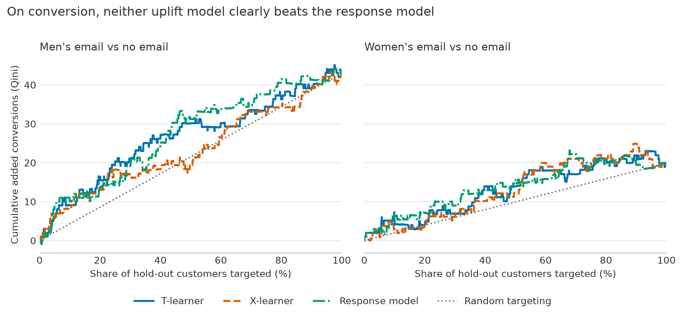
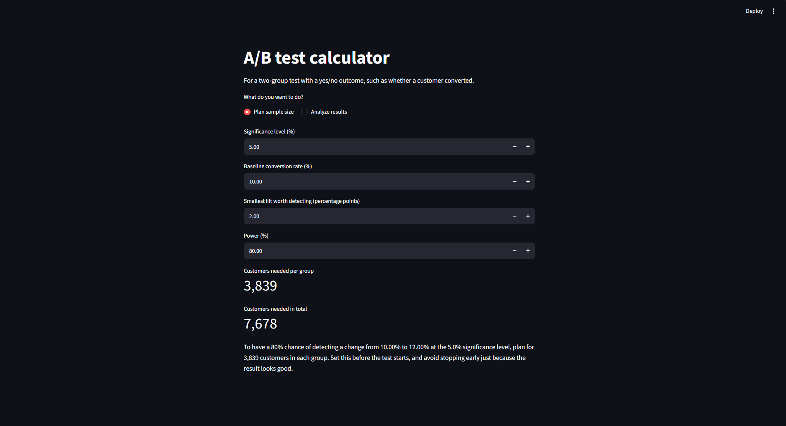
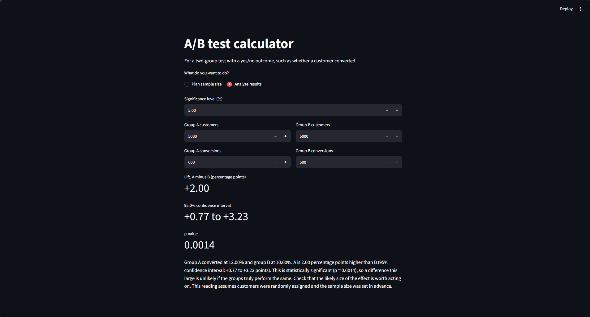

# email-uplift-ab-testing

**Who should a company email, and who would have bought anyway?** Sending an email costs money, and some customers buy without it. This project uses randomized experiments to measure the purchases an email actually adds, then asks whether targeting specific customers beats emailing everyone.

## Headline result

**Sending the men's email to everyone added 6.8 conversions per 1,000 customers (95% CI 5.0 to 8.6), worth about $104 per 1,000 ($50 to $158) under assumed costs of $0.10 per contact and $30 margin per conversion.** Those costs are placeholders, because the data contains no real ones.

About 5.7 of every 1,000 customers bought with no email at all. Uplift models did not reliably beat emailing everyone, or a simple model of who is likely to buy. The answer depends on cost: emailing everyone only pays when margin is about 150 times the contact cost or more.

Under a 10,000-customer limit, the [one-page memo](docs/memo.md) recommends budgeting as if the chosen customers were random, because the model's ranking is not proven to do better.

## Method

1. **Check the experiment.** Sample-ratio test, covariate balance, and A/A simulations to confirm the false-positive rate.
2. **Measure average lift.** Confidence intervals for conversion and visits, a bootstrap interval for spend, Holm correction across the three comparisons, and regression adjustment on past spend.
3. **Model individual uplift.** A T-learner and X-learner written in plain Python on LightGBM, compared with a response-model baseline. Only pre-treatment features are used, and nothing is fitted on the 30% hold-out.
4. **Check the tools.** The learners recover known effects on simulated data and match `scikit-uplift` and `econml`.
5. **Compare decisions.** The share of customers to target is chosen inside the training data, then scored on the hold-out, because a share picked on the hold-out would overstate profit.

Choices were recorded before results were computed, or marked as exploratory if they came after. See [docs/decisions.md](docs/decisions.md).

## Do the rankings beat random?



Across all customers, the men's email adds more conversions than the women's, shown by the higher end point. On conversion, no model's Qini area had an interval that excluded zero. The one strong uplift signal was for women's email **visits**, where the T-learner and X-learner beat the response model and stayed above random in all 10 repeat runs.

## Strategy comparison

Hillstrom, on the 30% hold-out, with 95% intervals. **All profit uses assumed costs** and is per 1,000 customers in the base, compared with emailing no one. Each model's share was chosen using training data only.

| Email | Strategy | Share contacted | Added conversions per 1,000 contacts | Profit per 1,000 customers | Gain vs emailing everyone |
|---|---|---|---|---|---|
| Either | Email no one | 0% | 0 | $0 | n/a |
| **Men's** | **Email everyone** | 100% | **6.7 (3.6 to 10.2)** | **$102 ($8 to $205)** | n/a |
| Men's | Top k by response model | 100% | 6.7 (3.6 to 10.2) | $102 ($8 to $205) | $0 |
| Men's | Top k by uplift (T or X) | 100% | 6.7 (3.6 to 10.2) | $102 ($8 to $205) | $0 |
| Women's | Email everyone | 100% | 3.1 (0.2 to 6.1) | -$7 (-$95 to $82) | n/a |
| Women's | Top k by response model | 10% | 11.9 (-2.0 to 23.6) | $26 (-$16 to $61) | $33 (-$54 to $110) |
| Women's | Top k by T-learner | 10% | 7.9 (-3.3 to 19.7) | $14 (-$20 to $49) | $21 (-$63 to $103) |
| Women's | Top k by X-learner | 20% | 3.5 (-3.6 to 10.3) | $1 (-$41 to $42) | $8 (-$75 to $83) |

**Second dataset: Lenta (687,029 customers).** All models again chose to contact everyone: 7.6 added store visits per 1,000 contacts (4.6 to 10.6). Lenta's outcome is a store visit rather than a purchase, so its money figures are illustrative only and are left out here. Rankings beat random in all 5 repeat runs, but the uplift models did not clearly beat the response model. An apparent advantage in the main run disappeared across other seeds.

## Improvements tried

These came after the main results, so they are exploratory and do not change the figures above. They used 10 new train and test splits of the same customers. Profit uses assumed costs and is per 1,000 customers.

| Improvement | Result | Verdict |
|---|---|---|
| Average 5 model seeds | Mixed: for the T-learner's Qini, better than a single seed in 7 of 10 splits for the men's email and 3 of 10 for the women's | No real gain. Seeds already agree closely (score correlations of 0.95 to 0.98) |
| Best email to everyone | $82 on average vs $102 for men's to everyone; beat it in 2 of 10 splits | No gain |
| Best email if predicted profitable | $68 on average vs $102; beat it in 0 of 10 splits | No gain |
| Best email within a 15.6% budget | $9 on average vs $11 for men's only; beat it in 5 of 10 splits | No gain |

**These runs also corrected an earlier result.** The T-learner's top 10,000 added 12.5 conversions per 1,000 in the first run but averaged 5.9 across these splits, against 6.7 for a random group. The first figure was partly luck, so the memo no longer relies on it.

## A/B test calculator

A small Streamlit app plans a sample size from the baseline rate, smallest lift worth detecting, significance level and power. It also reads finished results, giving the lift, confidence interval and a plain-English reading.





## Limitations

- **Costs are assumed.** Neither dataset contains costs or margins, and every money figure depends on these placeholders.
- **Few purchases.** Each Hillstrom conversion model trains on only about 85 to 190 purchases, so rankings are noisy.
- **Intervals leave out training randomness.** Bootstrap intervals hold the models fixed, which is why repeat runs with other seeds are reported as well.
- **Old, short-term data.** Hillstrom is one test from 2008 that measured two weeks, so long-term effects such as unsubscribes are not covered.
- **Lenta is not perfectly randomized.** Its groups differ by more than chance on some features. Lift fell from 7.4 to 5.6 per 1,000 (2.6 to 8.6) after comparing similar customers, and this can only correct for what the features measure. `age`, `gender`, `response_sms` and `response_viber` were excluded from its models.
- **Two datasets cannot show why results differ.** Lenta has more data, but also richer features and a different outcome.
- **Criteo was not used.** It was the original second dataset, but its download links returned 404 on 2026-11-02.

## How to run

These commands are for Windows PowerShell with Python 3.14.

```powershell
python -m venv .venv
.\.venv\Scripts\python.exe -m pip install --no-cache-dir --only-binary=:all: -r requirements-lock.txt
```

Download the datasets once. Hillstrom is about 0.4 MB and Lenta about 145 MB, and both are saved to `data/`, which git ignores.

```powershell
.\.venv\Scripts\python.exe -c "from src import load; load.load_hillstrom(download=True); load.load_lenta(download=True)"
```

| To do this | Run this with `.\.venv\Scripts\python.exe` |
|---|---|
| Run the tests | `-m pytest` |
| Stage 2: experiment analysis | `-m src.experiment` |
| Lenta experiment checks | `-m src.experiment lenta` |
| Stage 3: uplift models | `-m src.learners` |
| Stage 4: Hillstrom ROI | `-m src.roi` |
| Stage 4: Lenta ROI (slow) | `-m src.roi lenta` |
| Memo figures | `-m src.roi memo` |
| Qini figure | `-m notebooks.make_figures` |
| Improvements tried | `-m src.improve` |
| A/B test calculator | `-m streamlit run app.py --server.address localhost`, then open the address it prints |

## Data sources

- **Hillstrom:** [MineThatData E-Mail Analytics and Data Mining Challenge](https://blog.minethatdata.com/2008/03/minethatdata-e-mail-analytics-and-data.html), by Kevin Hillstrom.
- **Lenta:** BigTarget Hackathon, hosted by Lenta and Microsoft in 2020, loaded through [`scikit-uplift`](https://github.com/maks-sh/scikit-uplift) ([`fetch_lenta` docs](https://www.uplift-modeling.com/en/latest/api/datasets/fetch_lenta.html)). License: Not explicitly specified / Unknown.

The data is not stored in this repository. This project was done for educational purposes with no intent of commercializing.
